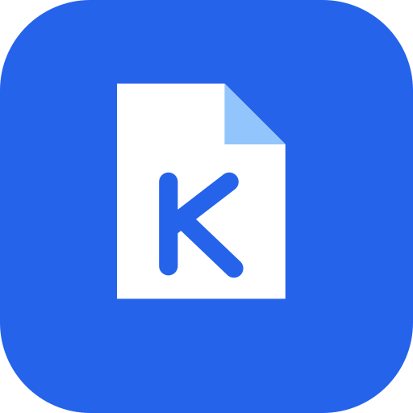

<p align="center">
  
</p>

<h1 align="center">Kagaz PDF</h1>

Self-hosted PDF toolkit: a web UI and REST API with 50+ tools to merge, split, rotate, compress, convert, OCR, sign, redact, watermark, edit and automate PDFs.

Kagaz PDF Pro is built on an MIT-licensed open-source PDF toolkit. See [NOTICE](NOTICE) and [LICENSE](LICENSE) for attribution and exactly what is included.

## What is included

Everything in upstream's MIT core: the full set of PDF tools and their REST endpoints (`/api/v1/...`, Swagger UI at `/swagger-ui/index.html`), the React web UI (file manager, page editor, viewer, tool chaining, automation pipelines), OCR, conversions, and multi-language UI.

## Added by Kagaz PDF (original code, Apache-2.0)

Login, SSO, audit and desktop features are original code written for this project:

| Feature | Where | Enable |
|---|---|---|
| Login, users, roles (ADMIN/USER), API keys | `app/auth` | `SECURITY_ENABLELOGIN=true` |
| Admin user page | `/admin-users.html` | admins only |
| Audit log + viewer | `/admin-audit.html`, file `kagaz-audit.log` | on with login |
| SSO (OpenID Connect, PKCE) | `app/auth` | `KAGAZ_AUTH_OIDC_ISSUER`, `..._CLIENT_ID`, `..._CLIENT_SECRET`, `KAGAZ_AUTH_PUBLIC_URL` |
| Desktop app (Electron) | `desktop/` | see `desktop/README.md` |
| Document assistant (summarize, ask a PDF) | `app/ai`, page `/ai.html` | `KAGAZ_AI_PROVIDER=anthropic` or `openai`, plus `KAGAZ_AI_API_KEY`, `KAGAZ_AI_MODEL`, optional `KAGAZ_AI_BASE_URL` (Ollama, vLLM, any OpenAI-compatible server) |
| Developer portal (API key, usage, examples) | `/developer.html` | on with login |
| Per-user daily request quota | `app/auth` | `KAGAZ_AUTH_QUOTA_DAILY_REQUESTS=500` (0 = unlimited, admins exempt) |

Login: on first start with login enabled an `admin` user is created. Set `KAGAZ_AUTH_ADMIN_PASSWORD`, or read the one-time password from the server log (it must be changed at first login). Scripts call the API with `X-API-KEY: kpdf_...` or `Authorization: Bearer kpdf_...`; keys are issued per user and stored hashed. Login is rate limited, passwords are BCrypt, sessions use `HttpOnly` + `SameSite=Lax` cookies, and cross-origin writes are refused.

SSO options (all `KAGAZ_AUTH_OIDC_*` env vars map to `kagaz.auth.oidc.*`): `ISSUER`, `CLIENT_ID`, `CLIENT_SECRET`, `SCOPES`, `LABEL`, `AUTO_CREATE` (default true), `ALLOWED_EMAIL_DOMAINS`, `ADMIN_EMAILS`. Register `<KAGAZ_AUTH_PUBLIC_URL>/api/v1/auth/sso/callback` as the redirect URI at your provider. SAML is not implemented; use an OIDC bridge (Keycloak, Authentik, Entra, Okta all offer one).

Limits you should know about: the React UI itself has no login screen; the server redirects unauthenticated browsers to `/login.html`. There are no teams, per-user quotas or per-tool permissions, and users live in a single file (`kagaz-users.tsv` in the config directory), which suits one server, not a cluster.

## Configuration

Every option is an environment variable; `.env.example` lists all of them. The AI assistant supports Anthropic, OpenAI, Gemini, OpenRouter, Groq, Mistral, Together, DeepSeek, xAI, Ollama, LM Studio, vLLM and any OpenAI-compatible server. Add your key later: until then the page says "Not ready yet" and nothing fails. Documents of any length are read in parts, scanned PDFs are read with OCR (Tesseract, offline), and uploads are unlimited unless you set a limit. See [DEPLOYMENT.md](DEPLOYMENT.md) for Docker, offline and online setups.

## What is not included

- Billing, payments and multi-tenant cloud accounts. This is a self-hosted app; the optional daily quota guards against runaway scripts and is off by default.
- The assistant sends document text to the model provider you configure. Use `ollama` (or another local server) with `KAGAZ_OFFLINE=true` when documents must not leave your network.

Telemetry is removed: the upstream PostHog key and Scarf pixel are gone and analytics default to off.

## Build and run

Requirements: JDK 25, Node 22+, [Task](https://taskfile.dev) (optional).

```bash
# frontend only (typecheck, test, build)
cd frontend && npm ci
npx tsc --noEmit --project src/editor/core/tsconfig.json
npx vitest run
npx vite build --mode core

# full app, backend serving the built frontend on :8080
./gradlew bootRun -PbuildWithFrontend=true

# or, with Task
task dev
```

Docker files and compose examples are in `docker/`.

## Naming compatibility

Internal Java package names and some environment variable prefixes are inherited from the base project and kept so existing configuration keeps working.

## License

Apache-2.0, copyright Kagaz Software Inc PDF. Upstream MIT portions keep their notice in [THIRD_PARTY_LICENSE_MIT.txt](THIRD_PARTY_LICENSE_MIT.txt). See [LICENSE](LICENSE) and [NOTICE](NOTICE). Third-party components keep their own licenses.
